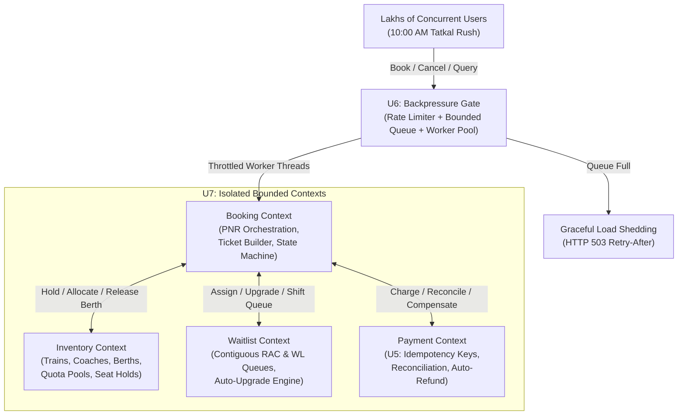
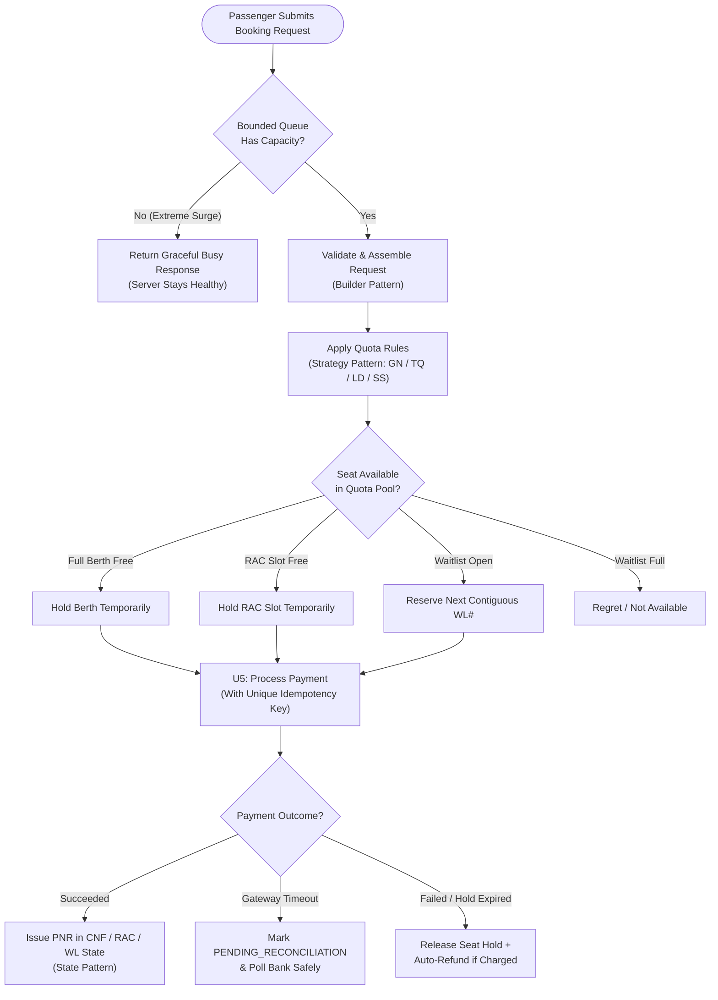
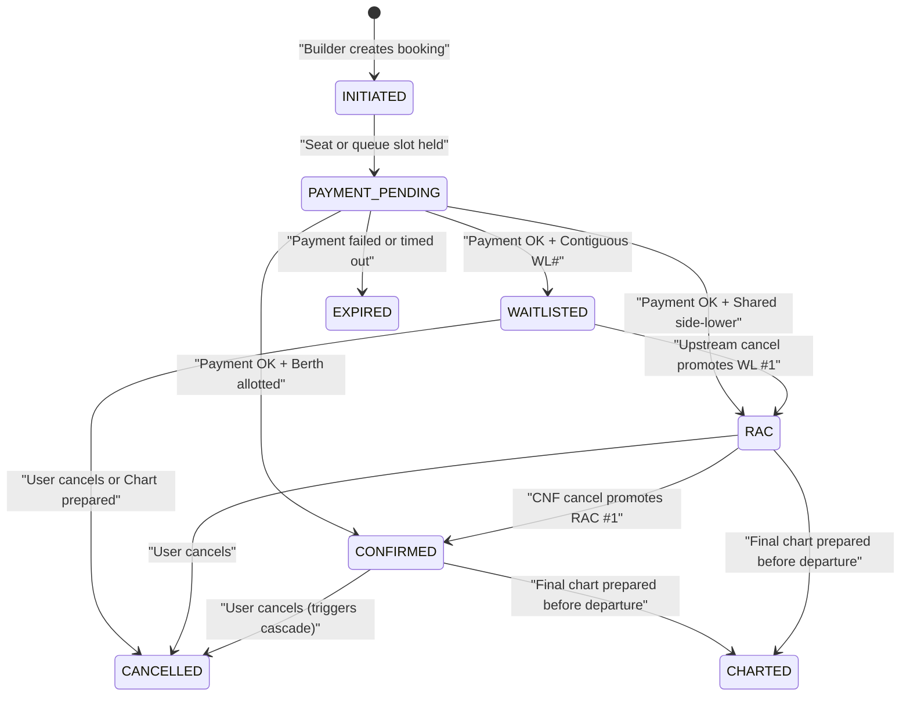

# Railway Reservation System (IRCTC-Style)

> **High-Concurrency Seat Booking, Quota Allocation & Tatkal Load Management**
>
> **Project Focus:** Software Engineering & Advanced Object-Oriented Programming (AOOP)  
> **Project Status:** Implemented — Spring Boot 3.5 + Spring Modulith 1.4 + Java 21 (JDK 25 Verified) + Interactive Control Center UI

---

## Plain-English Summary

> **In simple words:** An online train-ticket booking system that stays **fast, fair, and reliable** even when lakhs of users try to book at the exact same moment (like the 10:00 AM Tatkal rush).

Traditional reservation systems either lock the entire database (freezing everyone else out), hardcode quota rules into messy `if-else` trees, lose track of money during bank timeouts, or leave gaps in waitlist numbers (`WL1`, `WL3`...) when passengers cancel.  

This project solves all of those problems using **Object-Oriented Design**, **Design Patterns** (`Strategy`, `State`, `Builder`), **Bounded Backpressure Queues**, **Fault-Tolerant Payments**, and **Isolated Bounded Contexts**.

---

## What Makes This System Different?

| Traditional Pain Point | Root Cause | Our Design Solution | Unit / Pillar |
| :--- | :--- | :--- | :--- |
| **Double Booking & Crashes** | Race conditions during 10 AM Tatkal spikes | Partitioned seat locking + bounded request queues & thread throttling | **Unit 6** |
| **Monolithic Locking** | One giant app locking the whole database | Isolated services (**Bounded Contexts**) owning their own data & rules | **Unit 7** |
| **Hardcoded Quotas** | Rigid `if-else` conditionals for every quota | Polymorphic `QuotaStrategy` classes swapped cleanly at runtime | **OOP + Strategy** |
| **Money Deducted, No Ticket** | Bank gateway timeouts leaving bookings in limbo | Idempotency keys, timeout reconciliation & automatic refund compensation | **Unit 5** |
| **Broken Waitlist & RAC Gaps** | Ad-hoc cancellations leaving missing queue numbers | Contiguous queue engine + State pattern (`WL` → `RAC` → `CNF`) | **OOP + State** |

---

## High-Level System Architecture

Every request enters through a **Backpressure Gate (U6)** so sudden 10 AM Tatkal traffic cannot overwhelm the backend, and then flows across **four isolated Bounded Contexts (U7)**:



---

## How a Ticket Request Flows (At a Glance)



---

## Ticket State Lifecycle (Gap-Free Upgrades)

Whenever a confirmed passenger cancels, the system triggers an **atomic, gap-free cascade**: `RAC #1` upgrades to `CNF`, `WL #1` moves into `RAC`, and every remaining entry shifts up by `1` so no number gap is ever created.



---

## Repository Structure

```text
aoop-RRS-/
├── pom.xml                                   # Maven build (Spring Boot, Modulith, Resilience4j, Bucket4j, Caffeine, Disruptor)
├── Dockerfile & docker-compose.yml           # Optional Prometheus + Grafana observability container stack
├── monitoring/prometheus.yml                 # Actuator Prometheus scrape configuration
├── docs/                                     # Complete Framing, Architecture, Flowcharts & Ecosystem Docs (01–08)
├── src/main/java/com/irctc/rrs/
│   ├── RailwayReservationApplication.java    # Application entry point
│   ├── common/                               # Shared Kernel (Money, PartitionLockManager, Events, Exceptions)
│   ├── inventory/                            # Bounded Context 1: Coaches, Berths, Quota Strategies & Caffeine Holds
│   ├── waitlist/                             # Bounded Context 2: Contiguous RAC & WL Cascading Upgrade Engine
│   ├── payment/                              # Bounded Context 3: Idempotency Ledger, Timeout Reconciler & Saga Refunds
│   └── booking/                              # Bounded Context 4: Builder, TicketState, U6 Backpressure Gate & REST API
├── src/main/resources/
│   ├── application.yml                       # Tunable queue capacity, worker pool, hold TTL & reconciliation settings
│   ├── data/indian-railways-trains.json      # Real train catalog extracted from datameet/railways
│   └── static/index.html                     # Interactive IRCTC & 10 AM Tatkal Control Center UI
├── src/test/java/com/irctc/rrs/              # Spring Modulith verification, unit, cascade, payment & concurrency tests
└── tests/load/tatkal-surge.k6.js             # Grafana k6 load test simulating 10 AM Tatkal spike
```

---

## Quick Start

```bash
# Run full unit, Spring Modulith boundary, payment Saga, and concurrency tests
mvn test

# Start the reservation engine + live Control Center UI
mvn spring-boot:run
```

Once running, open **http://localhost:8080** in your browser for the interactive **IRCTC & Tatkal Control Center** (live berth grid, cancellation cascades, payment timeout reconciliation, and 10 AM Tatkal Surge Simulator).

---

## Documentation Index

Read the design documents in order for the complete framing of the project:

| # | Document | What You Will Find Inside |
| :-: | :--- | :--- |
| 01 | [PPT Analysis & Project Vision](docs/01-ppt-analysis-and-vision.md) | Full analysis of all 7 PPT slides, simple-word glossary, pain-point breakdown & solution mapping |
| 02 | [System Architecture & Tatkal Scale](docs/02-system-architecture.md) | U6 Backpressure & bounded queues, U7 Bounded Contexts, concurrency model & sequence diagram |
| 03 | [OOP Design & Design Patterns](docs/03-oop-and-design-patterns.md) | Encapsulation, Inheritance, Polymorphism, Abstraction + `Strategy`, `State`, `Builder` class diagrams |
| 04 | [Ticket Lifecycle & Contiguous Waitlist](docs/04-ticket-lifecycle-and-waitlist.md) | `WL → RAC → CNF` transitions, step-by-step cancellation cascade & chart preparation flowcharts |
| 05 | [Fault-Tolerant Payments (Unit 5)](docs/05-fault-tolerant-payments.md) | Idempotency keys, bank timeout reconciliation & Saga-style automatic refund compensation |
| 06 | [Domain Data Model](docs/06-domain-data-model.md) | Complete ER diagram, quota-pool breakdown & per-context data ownership rules |
| 07 | [Project Structure & Implementation Roadmap](docs/07-project-structure-and-roadmap.md) | Package dependency diagram, folder responsibilities, Units 1–7 alignment & build phases |
| 08 | [Integrated Open-Source Ecosystem](docs/08-reference-ecosystem.md) | All integrated libraries & datasets (`Spring Modulith`, `Resilience4j`, `Bucket4j`, `Disruptor`, `Caffeine`, `k6`, `datameet/railways`) |

---

## Implementation Status

- **Phase 0 — Idea Framing & Structure:** Completed
- **Phase 1 — Core Domain, OOP, Builder & Quota Strategies:** Completed (`Coach`, `Berth`, `QuotaStrategy`, `BookingRequestBuilder`)
- **Phase 2 — State Machine & Contiguous Waitlist Engine:** Completed (`TicketState`, `ContiguousQueue`, zero-gap cascade upgrades)
- **Phase 3 — High-Concurrency & Tatkal Backpressure (U6):** Completed (`PartitionLockManager`, `TatkalAdmissionGate`, `Bucket4j`, `Resilience4j`, `LMAX Disruptor`, `Caffeine`)
- **Phase 4 — Fault-Tolerant Payments & Reconciliation (U5):** Completed (`IdempotencyLedger`, `PaymentReconciliationWorker`, Saga `Refund`)
- **Phase 5 — Interactive UI, Integration Tests & Surge Verification:** Completed (`static/index.html`, JUnit 5 + Spring Modulith tests, `tatkal-surge.k6.js`)
