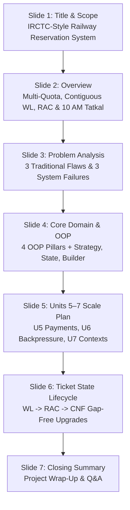
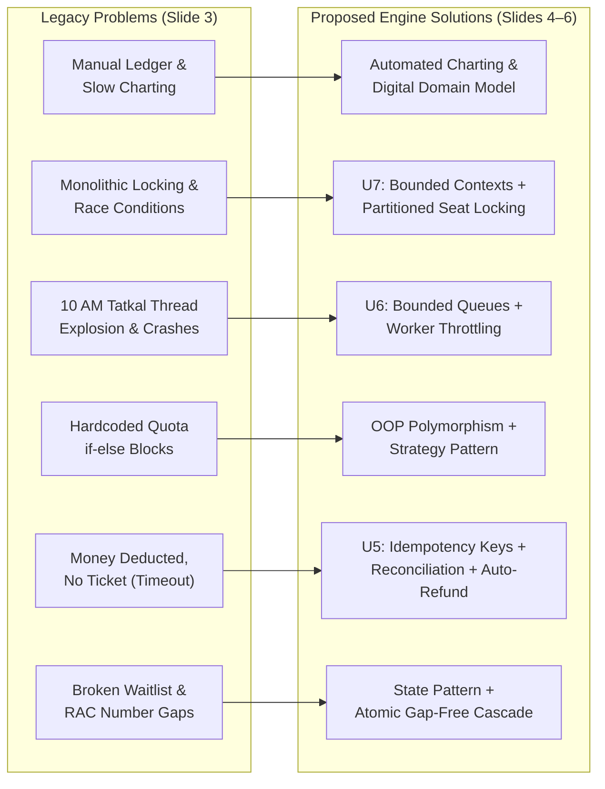

# 01 — PPT Analysis, Problem Framing & Project Vision

> **In simple words:** This document takes every slide from the project presentation and turns it into a clear, structured engineering blueprint—explaining *what* we are building, *why* older systems fail, and *how* each concept solves a real-world railway booking problem.

---

## 1. Slide-by-Slide Analysis of the Project PPT

### Slide 1 — Identity & Scope
- **Domain:** IRCTC (*Indian Railway Catering and Tourism Corporation*) style online train-ticket reservation engine.
- **Core Theme:** **High-Concurrency Seat Booking**, **Quota Allocation**, and **Tatkal Load Management**.

### Slide 2 — Project Abstract & Core Objectives
- **Formal Abstract:** *Resilient IRCTC-style reservation engine managing multi-quota seat allocation, contiguous waitlists, and automated RAC upgrades under extreme 10 AM Tatkal traffic surges.*
- **Plain-English Meaning:** *An online train-ticket booking system that stays fast, fair, and reliable even when lakhs of users try to book at the exact same moment.*
- **Four Core Objectives Derived from Slide 2:**
  1. **Fast under load:** Prevent server freeze or crash when 10:00 AM Tatkal booking opens.
  2. **Fair allocation:** First-come, first-served seat assignment with zero double bookings.
  3. **Rule-driven quotas:** Cleanly support multiple Indian Railways quotas (General, Tatkal, Ladies, Senior Citizen, etc.).
  4. **Reliable state & money:** Never lose track of payments or leave gaps in Waitlist / RAC numbers.

---

## 2. Deep Dive: Problem Analysis (Slide 3)

Slide 3 divides the problems into **two layers**: flawed *Traditional Methods* (how old systems were built) and *Operational Failures* (what goes wrong for real passengers).

### A. Traditional Reservation Methods (Root Causes)
1. **Manual Counter & Ledger Logs:**
   - Physical queues and slow, paper-based passenger chart updates before departure.
   - Zero real-time synchronization across remote booking stations.
2. **Monolithic Locking Systems:**
   - One single big application putting a global lock on the entire database.
   - Only one user can modify bookings at a time—causing severe bottlenecks when thousands click "Book Now" together.
3. **Hardcoded Quota Conditionals:**
   - Business rules buried inside giant `if-else` / `switch` chains (`if quota == "TATKAL" ... else if quota == "LADIES" ...`).
   - Adding a new quota or changing Tatkal opening timing forces risky edits across core booking code.

### B. Real-World System Failures (Symptoms)
1. **Double Booking & Server Crashes:**
   - *Race conditions* during the 10 AM Tatkal spike allow two concurrent requests to read the last available seat at the same millisecond and both claim it—or thread exhaustion crashes the server.
2. **Money Deducted, No Ticket:**
   - *Gateway timeouts* happen when the user's bank approves the payment slowly or replies late. The booking engine thinks the session failed while money was actually debited, leaving the passenger in limbo.
3. **Broken Waitlist & RAC Gaps:**
   - Poor cancellation logic deletes a waitlisted or RAC entry without re-indexing subsequent passengers, creating broken sequences like `WL1, WL3, WL4` instead of `WL1, WL2, WL3`.

---

## 3. Problem-to-Solution Mapping

Every problem from Slide 3 maps directly to a specific OOP concept (Slide 4) or Scale/Resilience mechanism (Slides 5–6):

| Pain Point | Concrete Failure Scenario | How Our Design Prevents It |
| :--- | :--- | :--- |
| **Double Booking** | Two users read `Seat B2-45 = AVAILABLE` concurrently | Partitioned per-train/date/class lock + temporary atomic **Seat Hold** before payment |
| **Server Crash at 10 AM** | 50,000 simultaneous threads exhaust RAM & DB pool | **Bounded Queue (U6)** caps active requests and sheds excess load gracefully |
| **Hardcoded Quotas** | New quota rule breaks existing General/Tatkal logic | **Strategy Pattern** isolates each quota rule into its own polymorphic class |
| **Payment Limbo** | Bank charges ₹1,800, webhook times out after 10s | **Idempotency Key + Reconciler (U5)** resolves unknown payment; **Auto-Refund** triggers if hold expired |
| **Waitlist Gaps** | `WL2` cancels; remaining entries stay `WL1, WL3` | **Waitlist Context (U7)** performs atomic shift (`WL3 -> WL2`) + `CNF -> RAC -> WL` cascade |

---

## 4. Non-Negotiable System Invariants

Before writing a single line of code, our system guarantees five strict rules at all times:

1. **Zero Overbooking Invariant:** For any `(Train, JourneyDate, Coach, Berth)`, at most **1 Confirmed** passenger—or at most **2 RAC** passengers sharing a designated Side-Lower berth—can occupy a slot at any instant.
2. **Contiguous Queue Invariant:** At all times, active RAC numbers are strictly `1..R` with zero gaps, and active Waitlist numbers are strictly `1..W` with zero gaps.
3. **FIFO Fairness Invariant:** Promotions always pick `RAC #1` first for freed full berths, and `WL #1` first for freed RAC slots.
4. **No Double-Charge / No Lost-Money Invariant:** Retrying a payment with the same `Idempotency-Key` never charges twice; any late payment after hold expiry triggers automatic refund compensation.
5. **Bounded Degradation Invariant:** Extreme 10 AM spikes never crash the server—excess load receives a clean, fast `Busy / Retry` response while admitted requests complete reliably.

---

## 5. Plain-English Glossary (PPT Terms & Domain Vocabulary)

| Term | Plain-English Meaning |
| :--- | :--- |
| **IRCTC** | Indian Railway Catering and Tourism Corporation—the official online train-ticket booking platform of Indian Railways. |
| **PNR** | *Passenger Name Record*—unique 10-digit reference number tracking one booking and all passengers under it. |
| **CNF (Confirmed)** | A full dedicated seat/berth is allotted to the passenger. Final success state of a booking. |
| **RAC (Reservation Against Cancellation)** | Passenger is allowed to board and travel, sharing one **Side-Lower** berth with another RAC passenger; first in line for a full berth upgrade. |
| **WL (Waitlisted)** | Ticket is booked into a numbered waiting queue (`WL1`, `WL2`...), with no seat yet; cannot board unless upgraded to RAC/CNF before charting. |
| **Contiguous** | Numbered sequentially without any missing numbers or gaps (`WL1, WL2, WL3...`). |
| **Chart** | Final passenger & berth assignment list prepared shortly before train departure. |
| **Monolithic** | One giant tightly coupled application where a single lock or crash affects every user and feature. |
| **Hardcoded** | Business rules directly embedded in conditional code so every policy tweak requires modifying core logic. |
| **Race Condition** | Two or more concurrent threads reading/writing the same seat simultaneously, risking double allocation. |
| **Gateway Timeout** | The bank or payment processor replies too slowly, leaving the booking system temporarily unsure if money was deducted. |
| **Idempotency Key** | A unique ID attached to a payment request so accidental retries return the original result instead of charging twice. |
| **Compensation (Saga)** | An automatic reversing action (like an automated refund) triggered when a booking fails after payment has succeeded. |
| **Throttling** | Limiting how many requests are processed concurrently so the system stays responsive instead of collapsing. |
| **Bounded Queue** | A waiting line with a fixed maximum capacity; protects servers from memory exhaustion during traffic spikes. |
| **Bounded Context** | An isolated domain service (`Inventory`, `Booking`, `Waitlist`, `Payment`) that owns its own data and rules independently. |

---

> **Next:** See [02 — System Architecture & Tatkal Scale](02-system-architecture.md) to explore how **Bounded Contexts (U7)** and **10 AM Backpressure (U6)** work together in detail.
