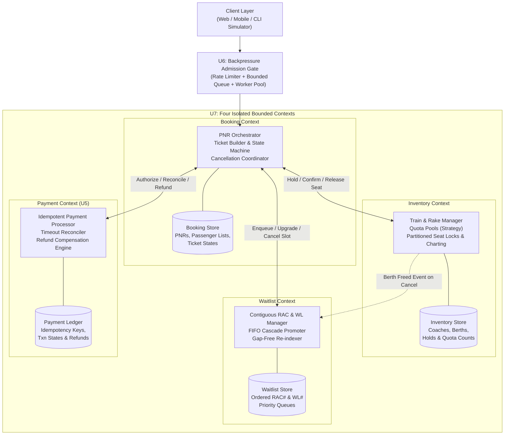
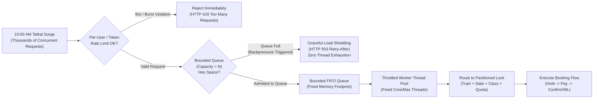
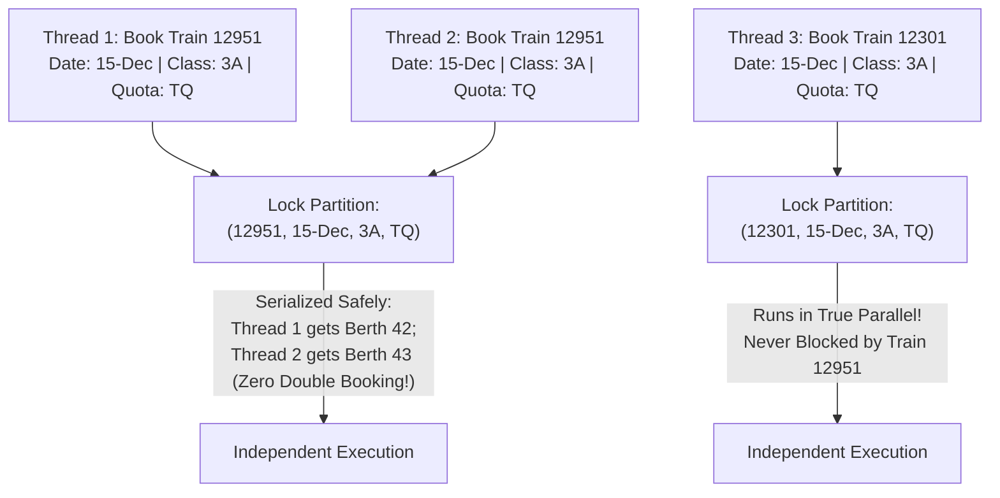
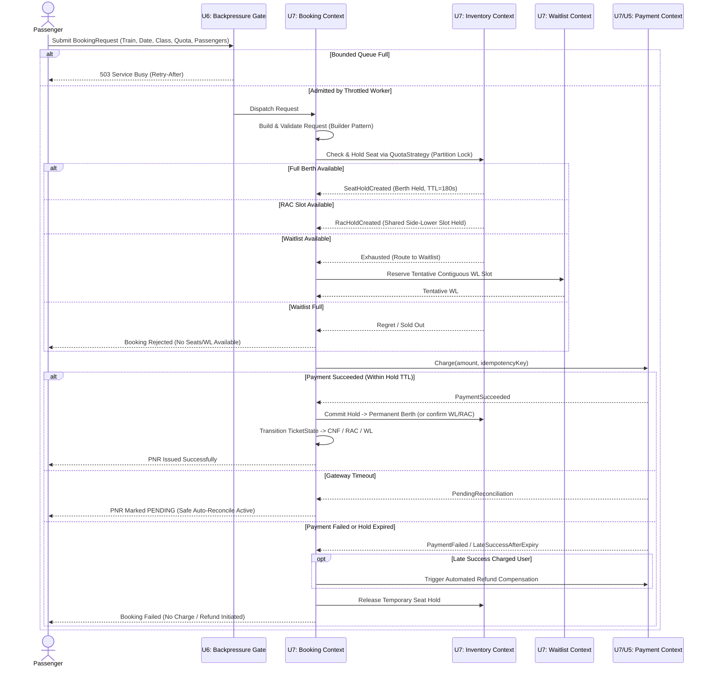

# 02 — System Architecture, Bounded Contexts (U7) & Tatkal Backpressure (U6)

> **In simple words:** Instead of one crowded counter where everyone pushes into one giant ledger at 10:00 AM, think of our system as a well-organized railway terminal: a **controlled entry gate (U6)** lets manageable batches inside so the hall never crashes, and **four specialized departments (U7)**—Booking, Inventory, Waitlist, and Payment—each manage their own work independently.

---

## 1. Unit 7 — Isolated Bounded Contexts

### Why Bounded Contexts?
In a traditional **monolithic locking system**, inventory counts, payment logs, waitlist numbers, and passenger records all share one database lock. If the payment gateway slows down, seat queries freeze; if waitlist shifts fail, the whole booking app stalls.

With **Bounded Contexts (Unit 7)**, we split the domain into **four isolated services**. Each context owns its own data model, internal invariants, and locks—and communicates with other contexts strictly through well-defined service interfaces or domain events.

### Bounded Context Responsibilities & Isolation Rules

| Bounded Context | Owns Exclusively | Must NEVER Touch Directly | Exposed Contract |
| :--- | :--- | :--- | :--- |
| **Booking Context** | PNR records, Passenger details, Booking Lifecycle State, Request validation | Raw berth locks, payment card/bank state, internal waitlist pointers | `createBooking()`, `cancelBooking()`, `getPnrStatus()` |
| **Inventory Context** | Train schedules, Coaches, Berths, Quota capacities (`GN`, `TQ`, `LD`, `SS`), Temporary seat holds, Final Chart | Payment transactions, PNR state objects | `checkAvailability()`, `acquireHold()`, `commitBerth()`, `releaseBerth()`, `prepareChart()` |
| **Waitlist Context** | Ordered `RAC` & `WL` queues per `(Train, Date, Class, Quota)`, contiguous positions | Berth layouts, payment gateway logic | `allocateWaitlistOrRac()`, `promoteOnCancellation()`, `removeAndShiftContiguous()` |
| **Payment Context** | Idempotency ledger, gateway adapters, timeout reconciliation jobs, refund records | Seat inventory, waitlist positions | `processPayment(idempotencyKey)`, `reconcilePending()`, `triggerRefund()` |

---

## 2. Unit 6 — 10 AM Tatkal Rush Backpressure & Concurrency

> **In simple words:** When 1,00,000 passengers click "Book" at `10:00:00 AM`, trying to handle all 1,00,000 requests on 1,00,000 simultaneous threads crashes the server. **Backpressure** puts a fixed-size waiting line (`Bounded Queue`) in front of a controlled team of worker threads (`Throttling`). Requests within capacity get smooth service; extreme overflow gets a quick, polite `"Server Busy, Try Again"` message instead of crashing everyone's session.

### Backpressure Pipeline Architecture

### Why Bounded Queues + Throttling Prevent Crashes

| Factor | Unbounded System (Naive) | Our Backpressure Design (Unit 6) |
| :--- | :--- | :--- |
| **Thread Count** | Spawns thousands of threads until OS/JVM runs out of memory | Fixed worker pool size matched to CPU & lock throughput |
| **Queue Memory** | Unbounded queue grows indefinitely during bank slowdowns (`OutOfMemoryError`) | **Bounded queue** strictly caps memory footprint |
| **Latency Under Load** | Every user waits 60+ seconds and times out simultaneously | Admitted requests finish fast; overflow fails fast in milliseconds |
| **Recovery** | Server crashes and requires manual restart at 10:02 AM | Server stays alive, drains queue smoothly, and recovers automatically |

---

## 3. Concurrency Control: Avoiding Both Race Conditions & Global Freeze

### Monolithic Global Lock vs. Partitioned Locking

Traditional systems lock the **entire database**, which forces a passenger booking **Rajdhani Express (New Delhi → Mumbai)** to wait behind someone booking **Shatabdi Express (Chennai → Bengaluru)**!

Instead, our **Inventory & Waitlist Contexts** use **Partitioned Locking** keyed by:

`Partition Key = (TrainNumber, JourneyDate, CoachClass, QuotaCode)`

### Two-Phase Reservation Window (Why We Hold Before Charging)
We **never** hold an exclusive in-memory lock while waiting 5–30 seconds for a bank payment gateway! Look at how we keep lock hold times in **microseconds**:
1. **Acquire Partition Lock (Microseconds):** Check quota availability, reserve a temporary **Seat Hold** (e.g., valid for `TTL = 180 seconds`) or reserve a tentative queue slot, then **immediately release the lock**.
2. **Process Payment Outside the Lock (Seconds):** Call the Payment Context using a unique `Idempotency-Key`. Other users booking the same train can still reserve other seats concurrently!
3. **Finalize or Release (Microseconds):**
   - If Payment **Succeeds** within TTL → convert the temporary hold into a **Confirmed / RAC / WL** allocation.
   - If Payment **Fails** or **TTL Expires** → release the held berth back to the pool cleanly.
   - If Payment **Arrives Late After Expiry** → trigger **Unit 5 Automated Refund Compensation**.

---

## 4. End-to-End Booking Flow (Sequence Diagram)

---

> **Next:** See [03 — OOP Design & Design Patterns](03-oop-and-design-patterns.md) for how **Encapsulation, Inheritance, Polymorphism, Abstraction** and **Strategy, State, Builder** structure the codebase cleanly.
