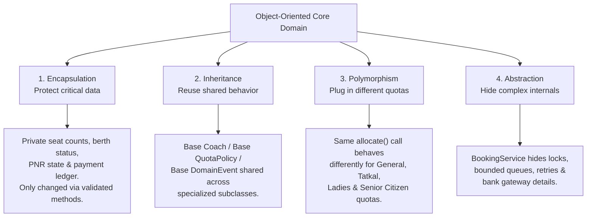
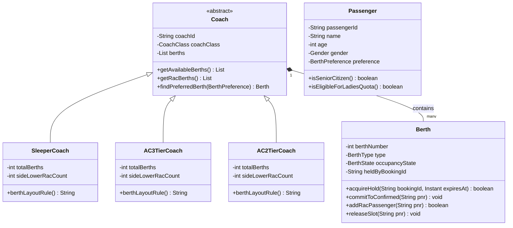
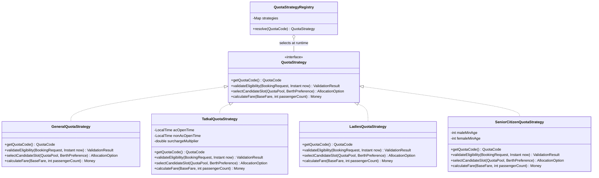
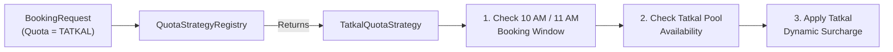
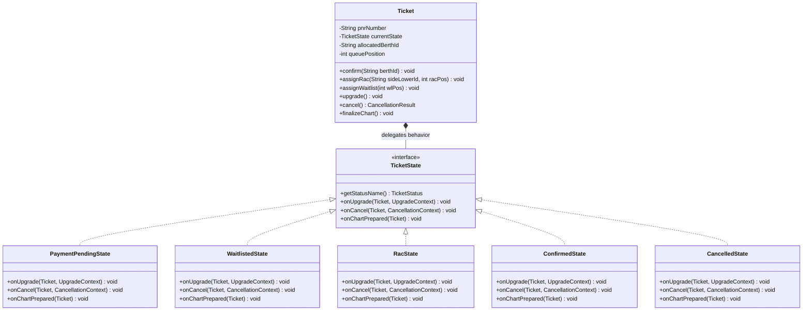
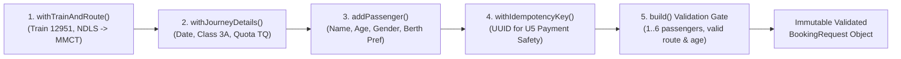
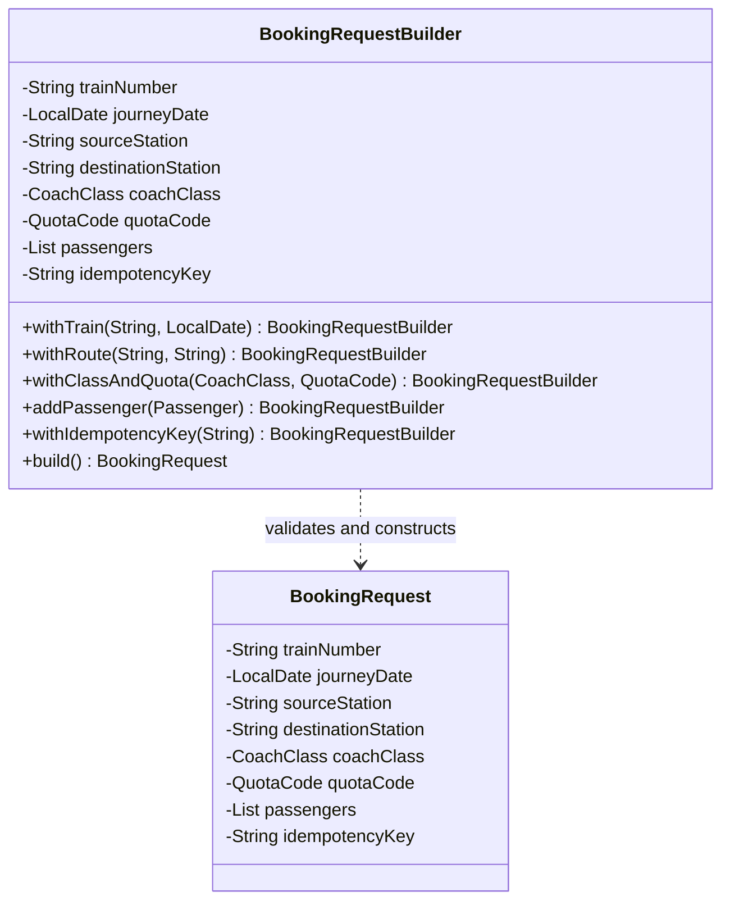
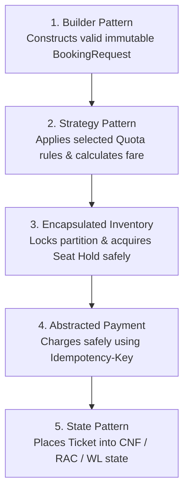

# 03 — Core Domain, OOP Pillars & Design Patterns

> **In simple words:** Instead of writing one tangled script full of `if-else` checks, we organize our railway system like real-world objects—a `Ticket`, a `Coach`, a `Berth`, a `QuotaPolicy`—each protecting its own rules and plugging together cleanly like Lego blocks.

---

## 1. How the Four OOP Pillars Map to Our Project (Slide 4)

| OOP Pillar | PPT Definition | Concrete Application in Our System | Why It Matters |
| :--- | :--- | :--- | :--- |
| **Encapsulation** | *Protecting important booking data* | `Berth.status`, `QuotaPool.availableSeats`, `Ticket.currentState`, and `PaymentRecord.idempotencyKey` are `private`. State transitions only happen through guarded domain methods (e.g., `hold()`, `confirm()`, `cancel()`). | Prevents accidental negative seat counts, invalid status jumps (like `WL -> CHARTED`), or unvalidated berth edits. |
| **Inheritance** | *Reusing common features* | `BaseCoach` shares coach code, capacity, and berth lookup across `SleeperCoach`, `AC3TierCoach`, `AC2TierCoach`, `ChairCarCoach`. `BaseQuotaPolicy` shares common passenger/date validation across quota implementations. | Eliminates duplicated coach and validation logic across train classes. |
| **Polymorphism** | *Supporting different booking quotas* | `QuotaStrategy` interface defines `allocate()` and `calculateFare()`. `GeneralQuota`, `TatkalQuota`, `LadiesQuota`, and `SeniorCitizenQuota` each implement their own eligibility and timing rules. | Eliminates Slide 3's *"Hardcoded Quota Conditionals"*—adding a new quota requires zero changes to `BookingService`. |
| **Abstraction** | *Hiding unnecessary implementation details* | Callers interact with clean interfaces (`BookingService`, `PaymentGateway`, `WaitlistManager`) without knowing about `PartitionLock`, `BoundedQueue`, `IdempotencyLedger`, or gateway HTTP polling. | Keeps modules decoupled (Unit 7 Bounded Contexts) and easy to test independently. |

---

## 2. Core Domain Class Hierarchy (Inheritance & Encapsulation)

---

## 3. Design Pattern 1 — Strategy Pattern (Quotas & Dynamic Pricing)

### Problem Solved
In legacy systems, quota logic is trapped inside giant `if-else` blocks:
- *General (`GN`)* allows booking up to 60–120 days ahead, standard fare, supports RAC & WL.
- *Tatkal (`TQ`)* opens strictly at `10:00 AM` (AC) / `11:00 AM` (Non-AC) one day before departure, charges dynamic Tatkal surcharge, enforces stricter cancellation refund rules.
- *Ladies (`LD`)* restricts allocation to eligible female/child passengers.
- *Senior Citizen (`SS`)* prioritizes Lower Berths for eligible elderly passengers.

### Solution with Strategy Pattern
> **In simple words:** The Booking Engine asks the selected `QuotaStrategy` *"Can this passenger book under your rules, and what is the fare?"* Each quota plugs in its own rulebook without changing the booking engine.

---

## 4. Design Pattern 2 — State Pattern (Ticket & PNR Lifecycle)

### Problem Solved
A railway ticket behaves completely differently depending on its current state (`INITIATED`, `PAYMENT_PENDING`, `WAITLISTED`, `RAC`, `CONFIRMED`, `CANCELLED`, `CHARTED`):
- Can a `WAITLISTED` ticket be upgraded? **Yes**, to `RAC`.
- Can an `RAC` ticket be upgraded? **Yes**, to `CONFIRMED`.
- Can a `CONFIRMED` ticket be upgraded? **No**, it is already at the highest travel state—and cancelling it must release a physical berth and trigger an `RAC #1 -> CNF` promotion!
- Can a `CANCELLED` ticket be cancelled again or promoted? **No**, invalid transition!

### Solution with State Pattern
> **In simple words:** Instead of checking `if status == WL ... else if status == RAC ...` everywhere, each Ticket State is an object that knows exactly what actions are allowed in that state and what state comes next.

---

## 5. Design Pattern 3 — Builder Pattern (Validated Multi-Passenger Bookings)

### Problem Solved
Creating a railway booking involves many required and optional parts: train ID, journey date, boarding & destination stations, coach class, quota code, 1–6 passengers (with age, gender, berth preference), contact info, and idempotency key. Passing 12 arguments to a constructor is error-prone and unreadable.

### Solution with Builder Pattern
> **In simple words:** `BookingRequestBuilder` collects each piece of the trip step-by-step and validates all rules (like max 6 passengers per PNR, valid station order, Tatkal passenger limit) before creating an immutable, guaranteed-valid `BookingRequest` object.

---

## 6. How All Patterns Work Together on a Single Booking

---

> **Next:** See [04 — Ticket Lifecycle & Contiguous Waitlist](04-ticket-lifecycle-and-waitlist.md) for the complete `WL → RAC → CNF` state machine and gap-free cancellation upgrade flowcharts.
