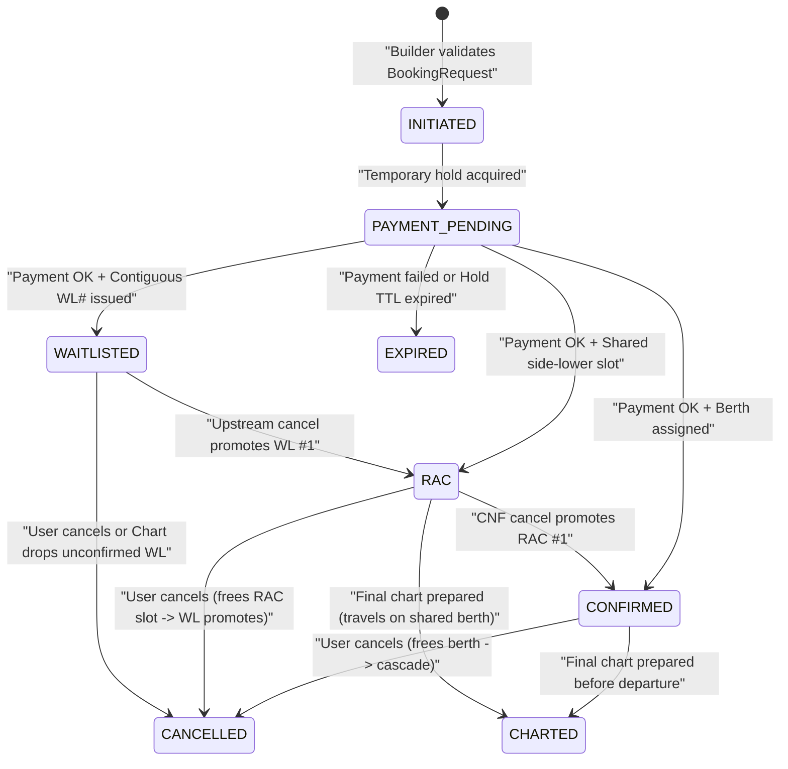
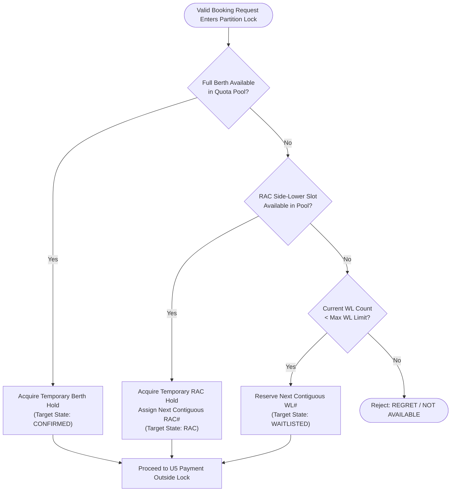
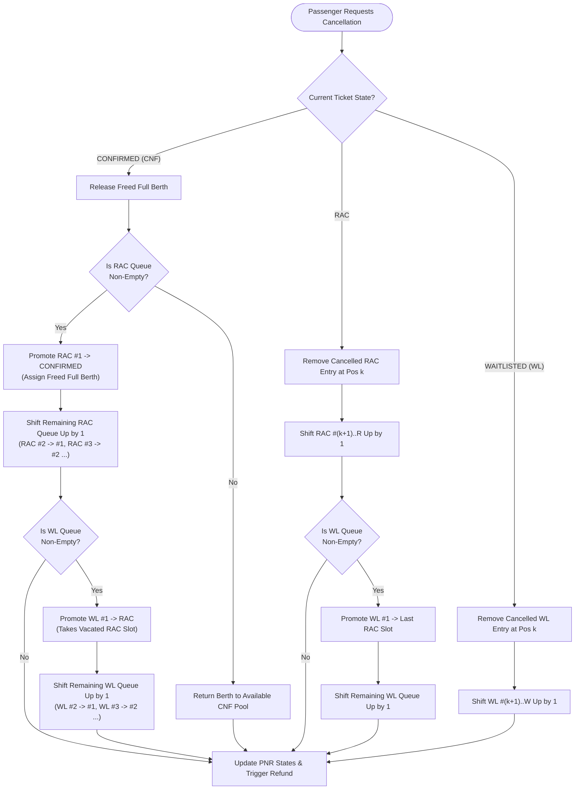
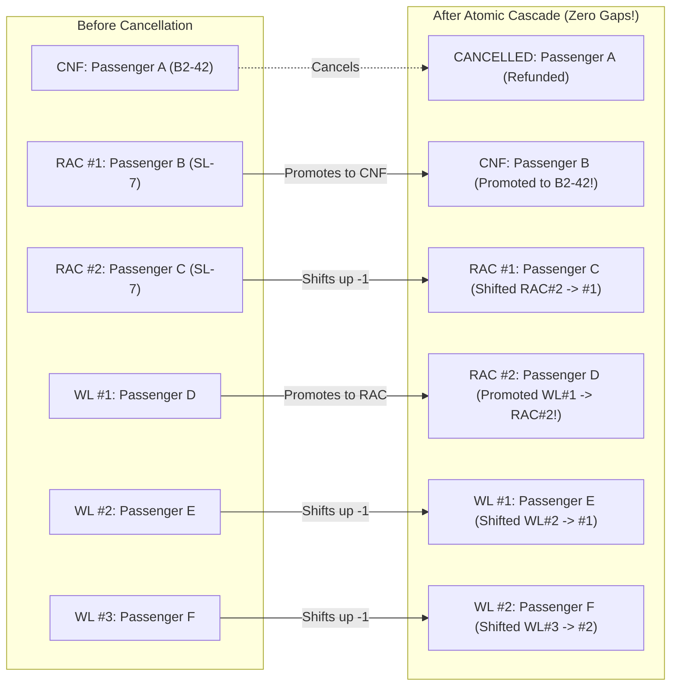
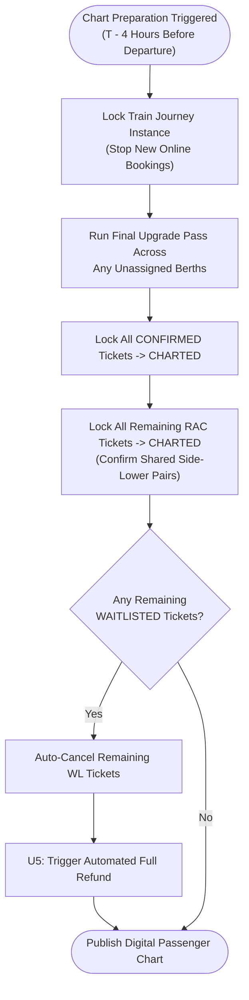

# 04 — Ticket State Lifecycle & Contiguous Waitlist Upgrades

> **In simple words:** Every ticket moves through a strict life cycle—starting from **Waitlisted (WL)**, upgrading to **RAC** (shared side-lower berth), and reaching **Confirmed (CNF)** (a full berth). Whenever anyone cancels, our queue shifts forward cleanly by one spot so numbers never have missing gaps like `WL1, WL3`.

---

## 1. The Three Core Travel States (Slide 6)

| State | Meaning in Plain English | Can Board Train? | Berth Assignment |
| :--- | :--- | :--- | :--- |
| **Waitlisted (`WL`)** | Booked into an ordered waiting line (`WL1, WL2...`), no seat yet | **No** (Auto-cancelled & refunded if still WL at charting) | None |
| **RAC (`RAC`)** | *Reservation Against Cancellation* — guaranteed boarding on a shared seat | **Yes** | Shares 1 Side-Lower berth with 1 other RAC passenger |
| **Confirmed (`CNF`)** | Final successful booking with a dedicated full berth | **Yes** | Dedicated full berth (e.g., `Coach B2, Berth 42 - Lower`) |

---

## 2. Complete Ticket / PNR State Machine

---

## 3. New Booking Seat Allocation Flowchart

When a passenger books a seat under a chosen `QuotaStrategy`, the system assigns the highest available tier in strict priority order: **`CNF` → `RAC` → `WL` → `Regret`**.

---

## 4. Contiguous Cancellation & Cascading Upgrade Engine

### Why Legacy Waitlists Break
In traditional systems, cancelling `WL #2` deletes row #2 and leaves `WL #1, WL #3, WL #4`—or cancelling a `CNF` seat leaves a berth idle while `RAC` passengers wait.

### Our Atomic Gap-Free Upgrade Rule (Slide 6)
Every cancellation runs inside the train partition lock as **one atomic operation** covering all three scenarios:

---

## 5. Step-by-Step Visual Example of a Gap-Free Cascade

Suppose **Passenger A** (Confirmed on `Berth B2-42`) cancels while 2 passengers are in RAC and 3 passengers are Waitlisted:

Notice the invariant:
- Before: `RAC = {1, 2}` and `WL = {1, 2, 3}` (contiguous).
- After: `RAC = {1, 2}` and `WL = {1, 2}` (still 100% contiguous, zero gaps, and the freed berth `B2-42` is immediately utilized).

---

## 6. Pre-Departure Chart Preparation Flow (Slide 3 + Slide 6)

Before departure (typically 4 hours prior in IRCTC), the **Chart** (final passenger manifest) is prepared:

---

> **Next:** See [05 — Fault-Tolerant Payments (Unit 5)](05-fault-tolerant-payments.md) to learn how payments, timeouts, and automatic refunds never leave a passenger without a ticket or money.
