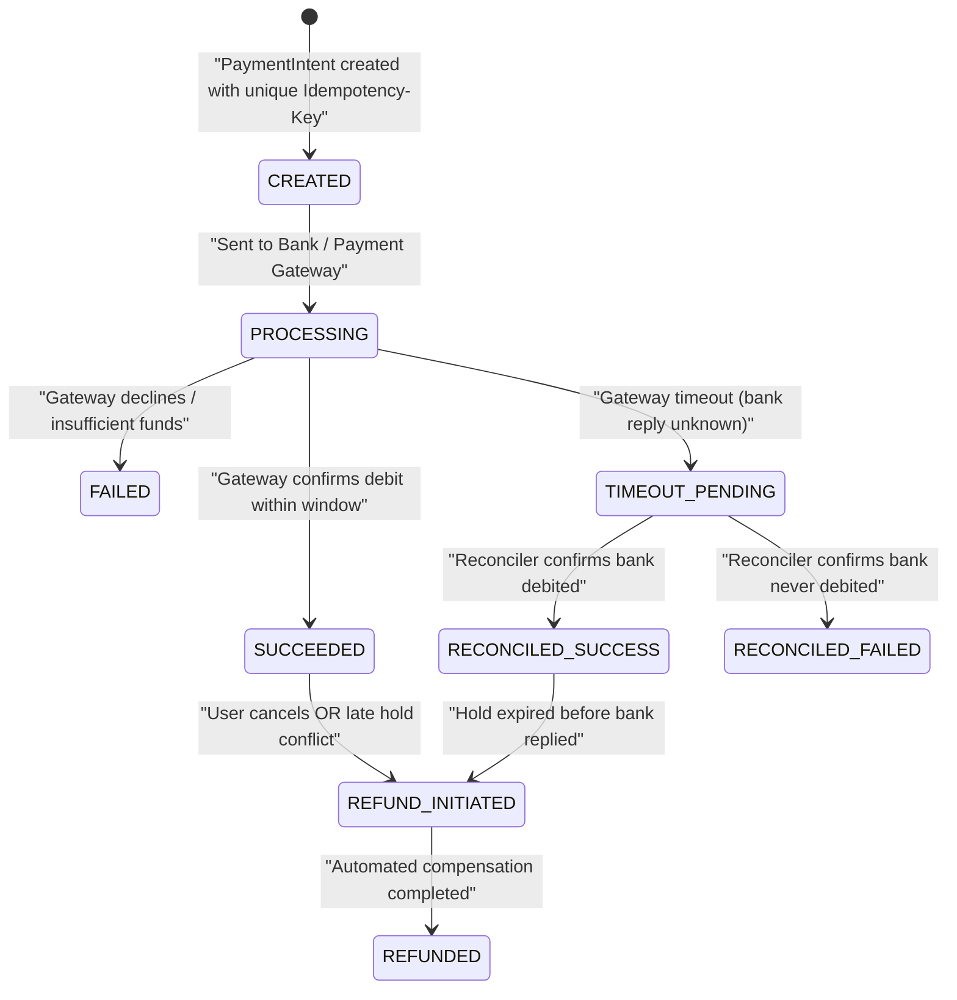
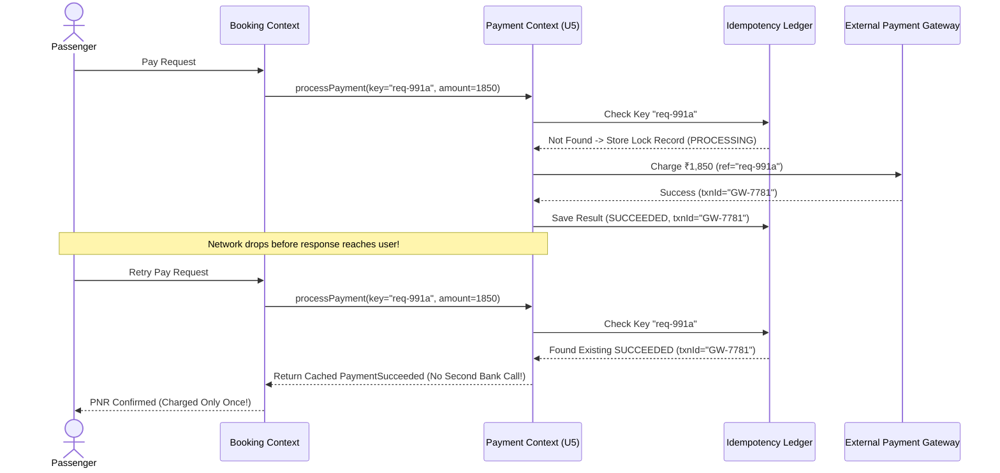
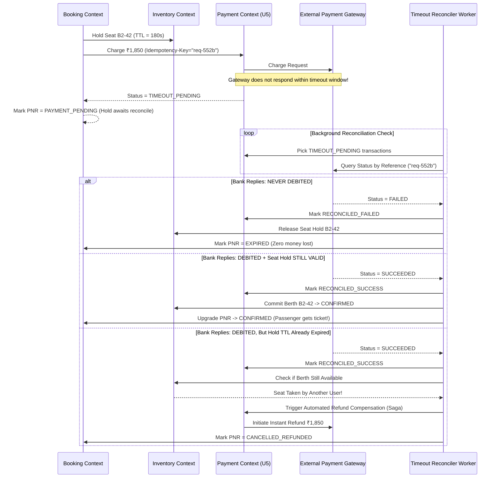
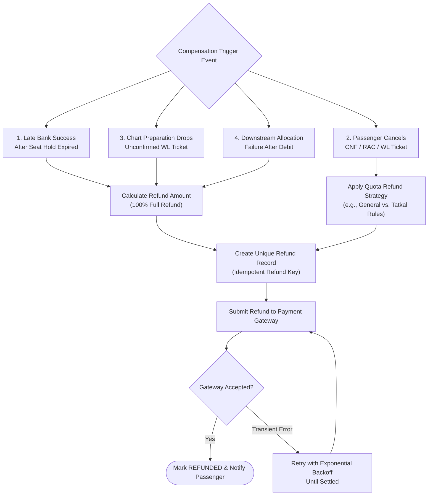

# 05 — Fault-Tolerant Payments (Unit 5)

> **In simple words:** One of the biggest nightmares in ticket booking is *"Money got deducted from my bank account, but no ticket was issued!"* Unit 5 solves this permanently using three safeguards: **Idempotency Keys** (so retries never charge twice), **Timeout Reconciliation** (checking late bank replies automatically), and **Automated Refund Compensation** (giving your money back automatically if the seat expired while the bank was slow).

---

## 1. The Three Payment Safeguards (Slide 5 — Unit 5)

| Mechanism | Plain-English Meaning | What Failure It Eliminates |
| :--- | :--- | :--- |
| **Idempotency Keys** | A unique ID attached to every payment attempt (`UUID`). If the browser refreshes or the network retries, the server returns the *first* result instead of charging again. | **Double charging** during shaky mobile internet or panic double-clicks at 10 AM |
| **Timeout Reconciliation** | If the bank replies too slowly (`Gateway Timeout`), we do **not** blindly mark the booking failed. We mark it `TIMEOUT_PENDING` and safely poll/reconcile with the bank. | **"Limbo bookings"** where the bank debits money after the booking app gave up |
| **Automated Refund Compensation** | If the bank confirms payment *after* our temporary Seat Hold expired (or after another check failed), a **Saga Compensation** step triggers an automatic refund immediately. | **Money deducted, no ticket** without manual customer-support intervention |

---

## 2. Payment Transaction State Lifecycle

---

## 3. Idempotency Key Flow (Zero Double-Charging)

---

## 4. Gateway Timeout Reconciliation & Late-Success Compensation

When a bank gateway hangs during the 10 AM Tatkal rush, our system cleanly separates **what the bank did** from **whether the seat hold is still valid**:

---

## 5. Automated Refund Compensation Decision Flowchart (Saga Pattern)

A refund is triggered automatically—with zero manual ticket-desk intervention—under four clear scenarios:

---

> **Next:** See [07 — Project Structure & Implementation Roadmap](07-project-structure-and-roadmap.md) to inspect how all modules, folders, tests, and implementation phases fit together.
