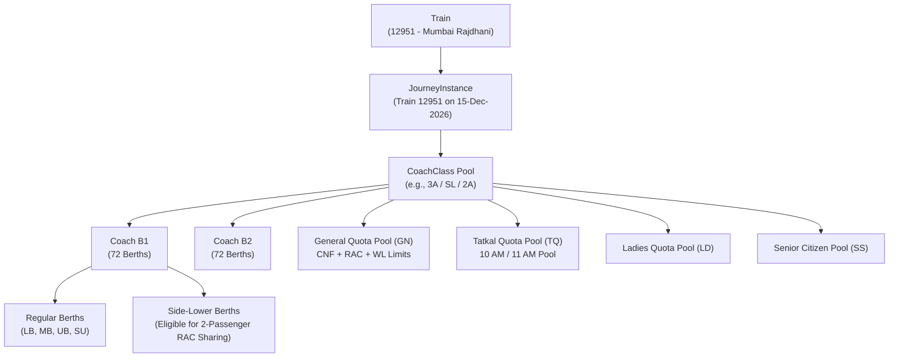
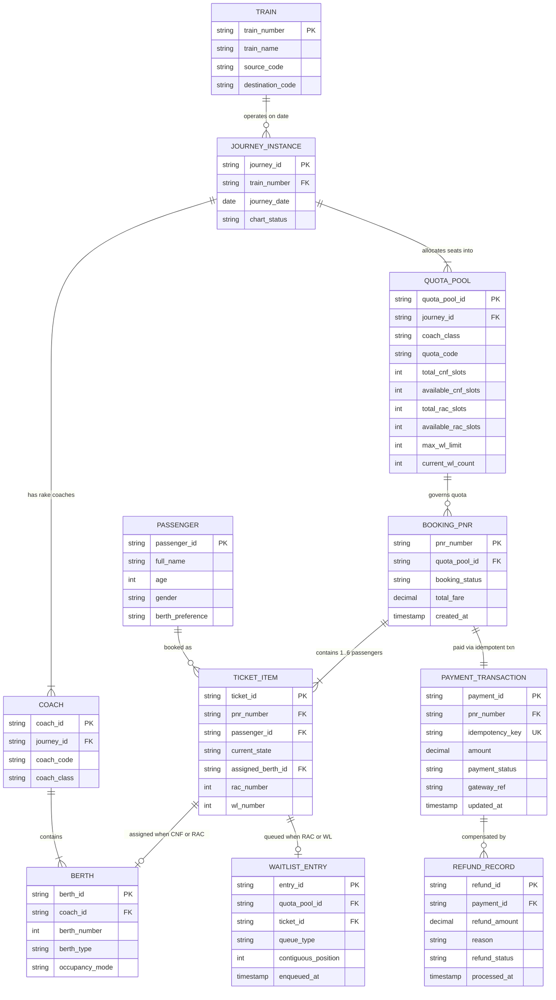
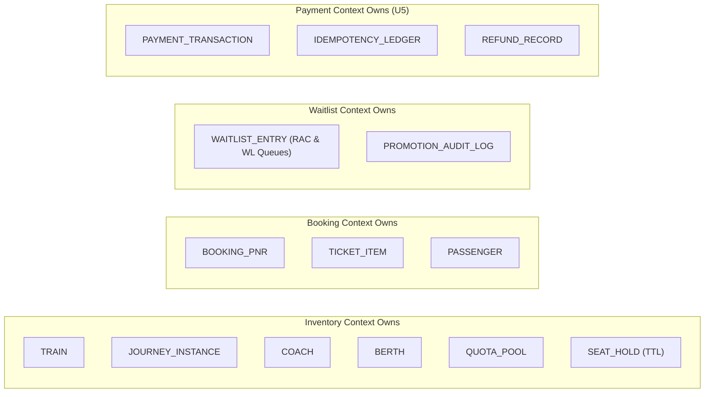

# 06 — Domain Data Model & Ownership Boundaries

> **In simple words:** Every piece of information in our railway system has one clear home. A `Train` holds `Coaches`, `Coaches` hold `Berths`, each `JourneyInstance` splits capacity into `QuotaPools`, and each of the **four Bounded Contexts (U7)** strictly owns only its own tables/entities.

---

## 1. Train → Coach → Berth → Quota Pool Hierarchy

A single physical train running on a specific date has coaches, physical berths inside each coach, and logical **Quota Pools** slicing those seats for General (`GN`), Tatkal (`TQ`), Ladies (`LD`), and Senior Citizen (`SS`) passengers.

---

## 2. Conceptual Entity-Relationship (ER) Diagram

---

## 3. Bounded Context Data Ownership (Unit 7 Rule)

To enforce strict isolation (**Unit 7: Bounded Contexts**), **no service may directly mutate another service's entities**. Cross-context references use immutable IDs (`pnr_number`, `quota_pool_id`, `payment_id`, `berth_id`).

---

## 4. Key Data Constraints & Invariants

| Entity | Invariant / Constraint | Reason |
| :--- | :--- | :--- |
| `BERTH` | `CNF` allows max `1` `TICKET_ITEM`; `RAC` (Side-Lower only) allows max `2` `TICKET_ITEM`s | Prevents physical double-booking while supporting IRCTC RAC berth sharing |
| `QUOTA_POOL` | `0 <= available_cnf_slots <= total_cnf_slots` | Guarantees seat counts never go negative under concurrency |
| `WAITLIST_ENTRY` | `(quota_pool_id, queue_type, contiguous_position)` is unique & gap-free `1..N` | Enforces Slide 2 & 6 contiguous waitlist/RAC requirement |
| `PAYMENT_TRANSACTION` | `idempotency_key` has a strict `UNIQUE` constraint | Enforces Unit 5 "never charge twice on retry" rule |
| `TICKET_ITEM` | Cannot hold both `wl_number > 0` and `assigned_berth_id != null` simultaneously | Prevents corrupt hybrid ticket states |

---

> **Next:** See [04 — Ticket Lifecycle & Contiguous Waitlist](04-ticket-lifecycle-and-waitlist.md) and [05 — Fault-Tolerant Payments](05-fault-tolerant-payments.md) for detailed behavioral flowcharts.
