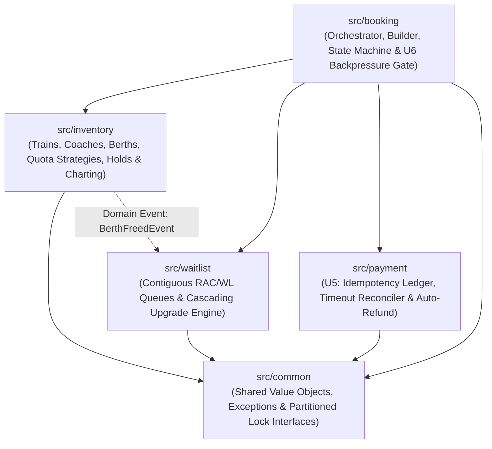
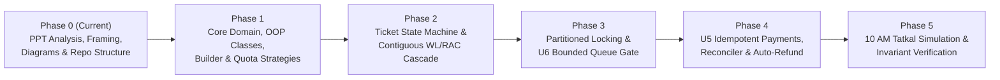

# 07 — Project Structure & Phased Implementation Roadmap

> **In simple words:** This document is the master folder map and build plan. Every module under `src/main/java/com/irctc/rrs/` corresponds to an isolated **Unit 7 Bounded Context** verified programmatically by **Spring Modulith**.

---

## 1. Module Dependency Architecture (Zero Circular Dependencies)

Every package under `com.irctc.rrs` maps directly to **Unit 7 (Bounded Contexts)** plus the open `common` shared kernel:



### Dependency Rules
1. **Acyclic Dependencies Only:** `common` depends on nothing; `inventory`, `waitlist`, and `payment` depend only on `common`; `booking` coordinates across the contexts via interfaces.
2. **No Cross-Context Data Mutation:** `booking` never reaches inside `inventory`'s seat map or `waitlist`'s queue directly—it calls service abstractions (`Abstraction` OOP pillar).
3. **Test Isolation:** `tests/` mirrors the `src/` packages so unit tests, concurrency stress tests, and end-to-end Tatkal simulations remain cleanly separated.

---

## 2. Complete Repository Blueprint

```text
aoop-RRS-/
├── README.md                                  # Project overview, executive diagrams & navigation
├── .gitignore                                 # Ignore rules for OS, IDEs & future build outputs
├── docs/                                      # Phase 0: Idea Framing, Flowcharts & Design Docs
│   ├── 01-ppt-analysis-and-vision.md          # Slide-by-slide PPT breakdown & Glossary
│   ├── 02-system-architecture.md              # U6 Backpressure & U7 Bounded Contexts
│   ├── 03-oop-and-design-patterns.md          # 4 OOP Pillars + Strategy, State & Builder
│   ├── 04-ticket-lifecycle-and-waitlist.md    # WL -> RAC -> CNF & gap-free upgrades
│   ├── 05-fault-tolerant-payments.md          # U5 Idempotency, reconciliation & compensation
│   ├── 06-domain-data-model.md                # Entities, ER diagram & ownership boundaries
│   └── 07-project-structure-and-roadmap.md    # Folder blueprint & implementation plan
├── src/                                       # Planned Implementation Skeleton (Module Stubs)
│   ├── README.md                              # Source module guide & rules
│   ├── common/                                # Shared value objects, errors & concurrency helpers
│   │   └── README.md
│   ├── inventory/                             # Bounded Context 1: Trains, Berths, Quotas & Holds
│   │   └── README.md
│   ├── booking/                               # Bounded Context 2: Backpressure, Builder & State
│   │   └── README.md
│   ├── waitlist/                              # Bounded Context 3: Contiguous WL/RAC Upgrade Engine
│   │   └── README.md
│   └── payment/                               # Bounded Context 4: Idempotent Gateway & Refunds
│       └── README.md
└── tests/
    └── README.md                              # Planned unit, concurrency & invariant tests
```

---

## 3. Mapping PPT Concepts & Units to Implementation Modules

| PPT Section / Unit | Key Concepts Covered | Target Module(s) |
| :--- | :--- | :--- |
| **Slide 3 — Problem Solving** | Digital charting, elimination of global DB locks, no hardcoded quota `if-else` | `src/inventory`, `src/booking` |
| **Slide 4 — OOP Pillars** | Encapsulation, Inheritance (`Coach`), Polymorphism (`QuotaStrategy`), Abstraction | `src/inventory`, `src/booking`, `src/common` |
| **Slide 4 — Design Patterns** | `Strategy` (Quotas & Fare), `State` (Ticket Lifecycle), `Builder` (`BookingRequest`) | `src/inventory` (`Strategy`), `src/booking` (`State`, `Builder`) |
| **Slide 5 — Unit 5** | Idempotency keys, timeout reconciliation, automated refund compensation | `src/payment` |
| **Slide 5 — Unit 6** | 10 AM rush backpressure, bounded queues, worker thread throttling | `src/booking` (Admission Gate) |
| **Slide 5 — Unit 7** | Isolated Inventory, Booking, Waitlist & Payment bounded contexts | All 4 contexts under `src/` |
| **Slide 6 — Lifecycle** | `WL -> RAC -> CNF` & atomic gap-free cancellation cascade | `src/waitlist`, `src/booking` |

---

## 4. Phased Implementation Roadmap



### Phase Breakdown

1. **Phase 0 — Idea Framing & Structure *(Completed Now)***
   - Full PPT analysis, plain-English framing, architecture & flowcharts, domain model, and clean module layout.
2. **Phase 1 — Core Domain & OOP Foundations**
   - Implement value objects (`PNR`, `Money`, `TrainId`), `Coach`/`Berth` hierarchy, `BookingRequestBuilder`, and `QuotaStrategy` variants (`GN`, `TQ`, `LD`, `SS`).
3. **Phase 2 — State Machine & Contiguous Waitlist Engine**
   - Implement `TicketState` implementations (`Waitlisted`, `RAC`, `Confirmed`, `Cancelled`, `Charted`) and the atomic gap-free upgrade engine.
4. **Phase 3 — Concurrency & 10 AM Rush Backpressure (U6)**
   - Implement `PartitionLockManager` (`Train + Date + Class + Quota`), temporary seat holds with TTL expiration, and `BoundedRequestQueue` + throttled worker pool.
5. **Phase 4 — Fault-Tolerant Payments (U5)**
   - Implement simulated payment gateway with configurable timeouts, `IdempotencyLedger`, background timeout reconciler, and Saga refund compensator.
6. **Phase 5 — Stress Simulation & Verification**
   - Run multi-threaded 10 AM Tatkal spike simulations verifying zero double-bookings, zero waitlist gaps, bounded queue shedding, and automatic payment reconciliation.

---

## 5. Pre-Implementation Decisions (To Finalize Before Phase 1)

Before writing code in Phase 1, the team will confirm:
- **Language & Runtime:** Java 21 (ideal for AOOP: records, sealed interfaces, `ReentrantLock`, `ArrayBlockingQueue`, `ExecutorService`) or alternative OOP stack.
- **Persistence Mode:** In-memory thread-safe repositories for rapid AOOP simulation first, with repository interfaces ready for optional SQL/PostgreSQL backing later.
- **Driver Interface:** Interactive CLI / Tatkal Stress Simulator first, with optional REST API controller layer on top of `src/booking`.
